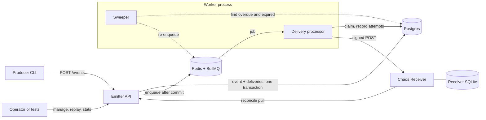
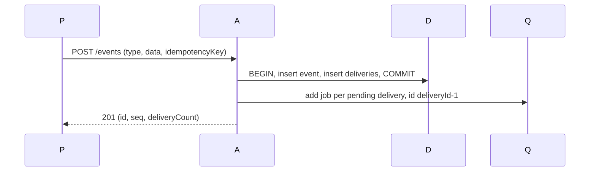
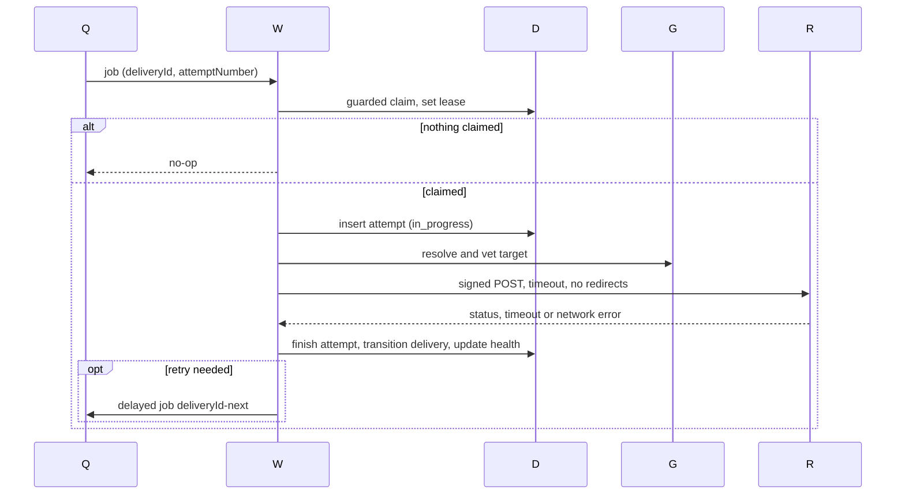

# Components

The pieces that run, how the code is layered, how they talk to each other, and how a request travels through the system. This is the map to read before changing anything structural. It describes the Emitter, a webhook delivery service that stores events, delivers them as signed HTTP requests to subscribers, and retries failures.

## Terms you will meet

- **Emitter, API, Worker:** the Emitter is made of an API process (the HTTP interface) and a Worker process (the part that actually sends requests).
- **Sweeper:** a background task inside the Worker that finds overdue or abandoned work and repairs it.
- **Guarded claim:** a single conditional database update that lets a worker start an attempt only if the delivery is in the expected state. If it matches nothing, the worker does nothing.
- **Lease:** a deadline written on a delivery when an attempt starts. If the worker dies, the deadline passes and the delivery can be recovered.
- **Hexagonal Architecture:** business rules sit in the center and never depend on technology. Technology plugs in from outside through ports (interfaces the inner code defines) and adapters (the real implementations of those interfaces).
- **Composition root:** the one place where adapters are created and connected to the code that uses them.
- **BullMQ:** a job-queue library that stores its jobs in Redis.

## What runs

Five runtime pieces cooperate, plus one tool you run by hand.

| Piece | Purpose | Scaling |
|---|---|---|
| Postgres | The source of truth for the Emitter. | One instance. |
| Redis with BullMQ | The execution queue. Append-only persistence is on and the memory policy is noeviction, so Redis never silently discards queue keys. | One instance. |
| API | The HTTP interface. It holds no state. | Horizontal. |
| Worker | The delivery processor plus the Sweeper. Several replicas are safe. | Horizontal. |
| Chaos Receiver | The unreliable client, with its own SQLite file and no shared code. | One instance. |
| Producer | Generates events and verifies the end state. A command-line tool, not a service. | On demand. |

Solid arrows are the main flow and dotted arrows are repair paths. Postgres is written by the API when publishing and by the Worker when recording attempts. The receiver never touches Postgres or Redis. It only speaks HTTP.

## How the code is layered

The Emitter follows Hexagonal Architecture with three layers, and dependencies only point inward.

- The core layer holds the domain: aggregates, value objects such as ids, the target URL, the retry policy and the signature header, domain services such as outcome classification, retry scheduling and endpoint health, and domain errors. It imports nothing else.
- The app layer holds one use case per API operation, plus ProcessDelivery (run by a queue job) and RecoverDeliveries (run by each Sweeper tick). It also declares the ports those use cases need. It imports only the core layer.
- The infra layer holds the adapters that implement the ports, the HTTP layer, configuration loading and logging. It imports the other two.

The API and Worker entrypoints are the composition roots: the only code that builds adapters and wires them into use cases. Once code exists, this dependency rule should be enforced by a lint rule, not only by this text.

The ports are the contracts the inner layers rely on:

- Repositories for endpoints, events and deliveries persist aggregates, and the delivery repository also performs the guarded claim and the recovery queries.
- A unit of work runs several repository calls in one database transaction.
- A delivery queue enqueues attempt jobs with an optional delay and reports queue counts.
- A webhook dispatcher sends one HTTP request with a timeout, no redirects and a bounded response, and returns a structured result.
- A target guard resolves a hostname, decides whether the destination is allowed, and returns the vetted address.
- A signer generates secrets and computes signatures.
- A clock, a random source and an id generator supply everything non-deterministic, so domain tests can run with fixed values.

All configuration is parsed and validated once at startup and passed inward as a typed object. No code reads environment variables directly.

## How the queue is used

Each attempt is its own job, runs once, and carries the delivery id and the attempt number. The job id is the delivery id and the attempt number joined by a dash, so adding the same job twice is ignored. The delay comes from the delivery's next attempt time. Completed jobs are removed so Redis does not grow without bound, and a limited number of failed jobs is kept for debugging.

The processor returns normally for every classified outcome, because a timeout, a 500 or a 410 are results to record, not errors. It throws only on unexpected bugs, which leave the delivery in_flight until its lease expires. BullMQ may hand a stalled job to another worker, so the processor must tolerate running twice. The guarded claim makes the second run a no-op.

The queue holds no business state. If every key were deleted, the Sweeper would rebuild all needed jobs from Postgres. Each scenario uses its own key prefix, so a Redis wipe in one scenario affects only its own keys.

## Where each guarantee lives

| Concern | Enforced by |
|---|---|
| One delivery per event and endpoint | A unique constraint on deliveries. |
| Event and deliveries created together | One transaction when publishing. |
| Only one runner per attempt | The guarded claim plus a unique constraint on delivery and attempt number. |
| Crash recovery | The lease expiry plus the Sweeper. |
| Lost or missing jobs | Sweeper re-enqueue with deterministic job ids. |
| Legal status changes | The Delivery aggregate. |
| Failure counter and auto-disable | The same transaction that finishes the attempt. |
| Secret limit | The Endpoint aggregate. |
| Receiver deduplication | The primary key on the inbox event id. |

## Publishing an event

Matching active endpoints get pending deliveries and matching disabled endpoints get held ones. If the enqueue fails or the process dies after the commit, the Sweeper repairs it. Publishing again with the same key and the same payload returns the original event and creates nothing.

## One delivery attempt

The finishing step is a single transaction, and Redis is touched only after it commits.

## Repair and catch-up

On every tick the Sweeper does two jobs. It enqueues pending deliveries that are overdue by more than a grace period, which covers lost jobs, a Redis wipe, and a crash between commit and enqueue. It also recovers in-flight deliveries whose lease expired, which covers a worker that died mid-attempt. Several Sweepers can run at once because enqueueing is idempotent and the recovery selection skips rows another Sweeper has locked.

Reconciliation is the receiver's own catch-up path. It pages through the events relevant to its endpoint after a stored cursor, and inserts each into its inbox by event id, ignoring duplicates. It is how a receiver recovers events whose deliveries went dead.
