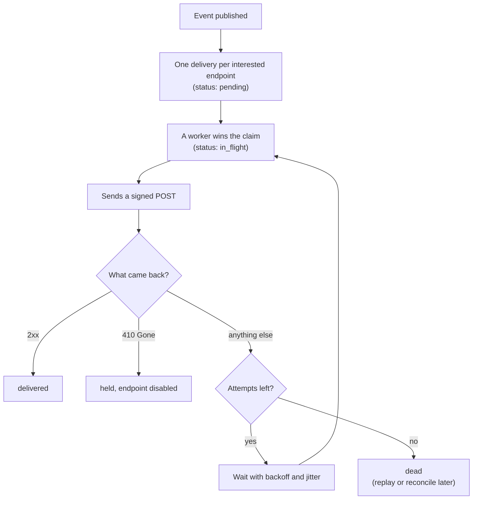

# Foundations

> **In one line:** we build both sides of a webhook system, one that delivers reliably and one that misbehaves on purpose, to prove that a messy network can still produce a correct result.

## The idea

A **webhook** is an HTTP POST that one system sends to another when something happens, so the second system never has to keep asking. Sending one is easy. Sending it **reliably** is the hard part, because networks fail, servers crash, receivers are slow, and the same message can arrive twice.

The **Emitter** (the delivery service we build) is built the way a real provider would build it, scaled down to a laboratory. Every problem has a matching answer in the design:

- **The receiver is down or errors:** retries with growing delays and a small random variation called jitter.
- **The receiver stays down for hours:** the delivery becomes dead, and can be replayed or reconciled.
- **A worker crashes or Redis loses its data:** a lease expires, Postgres (the database) holds the truth, and the Sweeper (a background repair task) rebuilds the jobs.
- **The same message arrives twice:** the receiver deduplicates on the event id.
- **Someone targets an internal address or forges a request:** the target guard and verified signatures stop it.

## The logic in one picture

> **Three ideas explain almost every design choice.**
> 1. **Postgres decides, Redis hurries.** The database holds the truth. The queue only makes things happen sooner, and it can be wiped at any time.
> 2. **Every attempt must win a claim.** A worker may run an attempt only if one guarded database update succeeds, which makes duplicated or stalled jobs harmless.
> 3. **Duplicates are expected, so the effect must be idempotent.** The Emitter may deliver twice. The receiver applies each event id only once.

## The cast

- **Emitter:** the system we build, an API process plus a Worker process from one codebase. Careful, persistent, secure.
- **Chaos Receiver:** the delivery target, with its own database. The customer from hell: it fails, duplicates, delays and drops on purpose.
- **Producer:** a command-line tool that publishes generated events. It knows the right answer in advance and checks the result.

## What we want to learn

1. **At-least-once delivery** and why it forces **idempotency** on both sides.
2. A **durable pipeline**: Postgres as the truth, Redis with BullMQ as the engine.
3. The **dual-write gap** between database and queue, and recovery from queue data loss.
4. **Backoff, jitter and Retry-After**, plus dead-lettering and manual replay.
5. **Secure outgoing webhooks**: HMAC signing, secret rotation, protection against SSRF (server-side request forgery, tricking a server into calling internal addresses), and never following redirects.
6. A **safe receiver**: verify, persist, acknowledge fast, process later, deduplicate.
7. **Chaos-style tests** that assert end states, not call sequences.
8. **DDD and Hexagonal Architecture** under real concurrency and failure. DDD (Domain-Driven Design) models the business rules explicitly. Hexagonal Architecture keeps those rules free of technology details.

## How we know it worked

The project is complete when all of these hold:

- ✅ All **18 scenarios** pass, repeatedly, with no manual intervention.
- ✅ A **1,000-event run** through a misbehaving receiver converges: every balance and profile version equals what the Producer expected.
- ✅ Wiping **all Redis queue data** while deliveries are pending loses nothing.
- ✅ Killing a **worker mid-attempt** loses nothing.
- ✅ Registering a **private or loopback address** is rejected whenever private targets are not allowed.

The phases that get us there, with their tasks, live in ROADMAP.md at the repository root.

## Vocabulary

These words always mean exactly this. Do not invent synonyms.

**The processes**
- **API:** the Emitter process that exposes the management and publishing HTTP interface.
- **Worker:** the Emitter process that executes delivery attempts and runs the Sweeper.
- **Sweeper:** a periodic task in the Worker that repairs gaps between Postgres and Redis.

**The data**
- **Endpoint:** a subscription, made of a destination URL, the event types it wants and its signing secrets.
- **Event:** an immutable fact with a type and a JSON payload.
- **Delivery:** the obligation to deliver one event to one endpoint. It owns the retry state.
- **Attempt:** one HTTP request made to fulfil a delivery.
- **Ledger:** the receiver's per-account state, built by applying events.

**The moves**
- **Lease:** a time-limited claim marking a delivery as being worked on.
- **Replay:** a manual request to deliver a dead or delivered delivery again.
- **Reconciliation:** the receiver pulling the events it missed, by cursor.
- **Quiescence:** the moment when nothing is pending or in flight.

**The ideas**
- **Idempotent:** safe to repeat. Doing it twice has the same effect as doing it once.
- **Backoff:** waiting longer after each failure, so a struggling endpoint is not hammered.
- **Guarded claim:** a single conditional database update that lets a worker start an attempt only if the delivery is in the expected state.
- **HMAC signature:** a value computed from the message and a shared secret, proving who sent it and that it was not altered.
- **Dead-lettering:** keeping a message that could not be delivered, with its history, instead of deleting it.

## Statuses and outcomes

A **delivery** is always in one of five statuses:

- **pending:** waiting for its next attempt.
- **in_flight:** an attempt is running right now.
- **delivered:** the receiver acknowledged it.
- **dead:** attempts exhausted, waiting for a replay.
- **held:** paused because its endpoint is disabled.

Every **attempt** ends with one of ten outcomes, which fall into four groups. What each one triggers is detailed in the Aggregates document.

- **It worked:** success (the receiver answered 2xx).
- **The endpoint is gone:** gone (410), after which the endpoint is disabled and the delivery held.
- **Try again later:** rate_limited (429), redirect (3xx, never followed), http_error (any other error status), timeout, network_error (connection, DNS or TLS failure) and blocked_target (the target guard refused the address).
- **Our own problem:** lease_expired (the worker vanished and the Sweeper closed the attempt) and internal_error (an unexpected bug in our processor). These never count against the endpoint.

## Delivery guarantees

**What we promise**
- ✅ **At-least-once delivery:** retried until success or exhaustion.
- ✅ **Exactly-once effect:** the receiver deduplicates on the event id.
- ✅ **Survives Redis data loss:** the Sweeper rebuilds jobs from Postgres.
- ✅ **Survives a worker crash:** the lease expires and the Sweeper recovers.

**What we do not promise**
- ❌ **Exactly-once delivery:** impossible over an unreliable network.
- ❌ **Ordering:** retries and concurrency reorder events, so receivers must cope.
- ❌ **Bounded delivery time:** the default schedule spans about 32 hours.

## Risks worth watching

- **A dependency misbehaves on Bun.** Phase 0 checks each one and records a fallback.
- **IP-pinned HTTPS is impossible with Bun fetch.** The Phase 0 spike decides, with the fallback already chosen in DEC-18.
- **Timing-based tests become flaky.** Compressed schedules, polling with timeouts, and end-state assertions.

The technical risks (lost jobs, stalled jobs, slow endpoints, cursor gaps) are answered by decisions DEC-03, DEC-04, DEC-15 and DEC-19.

## Out of scope

- **No user interface**, multi-tenant auth or quotas, ordering guarantees or exactly-once delivery.
- **No transformation, schema registry, secret encryption, data cleanup, ownership handshakes, non-HTTP targets, batching, high availability or per-endpoint concurrency limits.**
